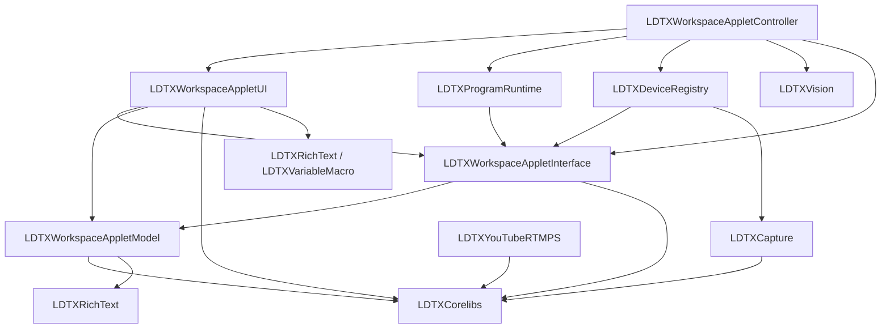
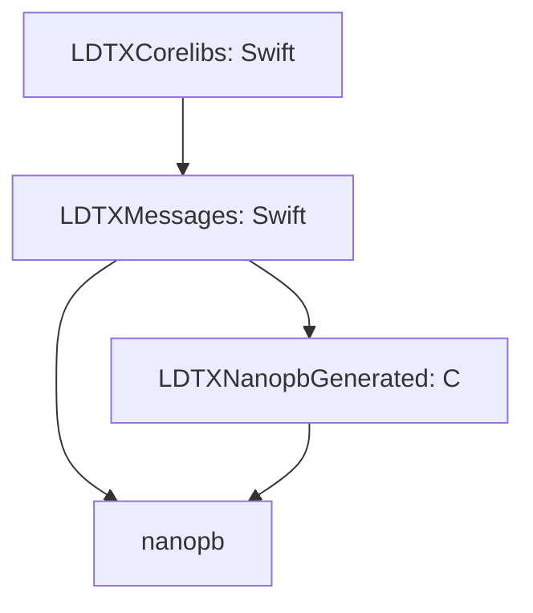

<!--
SPDX-FileCopyrightText: 2026 Kaito Udagawa <umireon@kaito.tokyo>
SPDX-License-Identifier: Apache-2.0
-->

# Target dependencies

Package targets are defined in `Packages/LDTXCorelibs/Package.swift`. Native macOS
targets are defined in `project/*.yml`. The diagrams below show the boundaries
affected by Workspace UI and message encoding; they omit unrelated targets and
system frameworks. Arrows point from a consumer to its dependency.

## Workspace presentation



Workspace UI consumes device-discovery, audio-peak and preview-accessibility
contracts rather than concrete services. The controller supplies the existing
runtime instances. The MTKView, preview delegate, Window/Document ownership and
AppDelegate composition root retain their existing lifetimes.

Vision model metadata is loaded through WorkspaceRuntimeActions. The coordinator
calls the classifier service and projects the result into a Foundation-only
WorkspaceVisionModelInformation value. UI does not import Vision or CoreML.
Camera/audio device descriptions, RTMPS configuration and transport values,
output actions and audio-master selection also live in Corelibs/Values; their implementations
remain in the capture, discovery, streaming and audio-engine modules.

UI still uses the lightweight Corelibs bundle values and document IO, model/editing
values, macOS value conversions and reusable text/view components. It has no
direct target dependency on ProgramRuntime, DeviceRegistry, Capture, Vision,
BackgroundSegmentation, VideoComposition, VideoRendering, TaskQueue, YouTube or
YouTubeRTMPS. Device previews use presentation fixtures; GPU preview
assembly is compiled in the controller target.

Corelibs depends on `LDTXMessages` and re-exports its Swift message API.
`Messages` is reserved for Protobuf within that module.

## Message encoding



LDTXMessages owns the Swift/C copying codec, message protocol, and generated models.
Each message generates direct `init(cMessage:)` and `write(to:)` conversions.
Shared functions handle strings, bytes, arrays, maps, enums, and C allocation
lifetimes; there are no KeyPath tables or type-erased field callbacks.
LDTXCorelibs owns shared values, Program definitions, and bundle IO.
LDTXNanopbGenerated exposes the official generator's typed C message structures
and their descriptors. The nanopb runtime owns decoded allocations until the
codec has copied them into Swift and calls pb_release.

C descriptor types are not promoted into the public message API. Corelibs exports
one dynamic product so the implementation is linked once per process.

## Verification

Build the shared module and run its tests:

```sh
swift build --package-path Packages/LDTXCorelibs
swift test --package-path Packages/LDTXCorelibs
```

The LDTXWorkspaceAppletUI scheme can be built without the runtime implementation
targets. Run UI component tests for document/editing behavior, and the existing
preview, device discovery, output, CLI and XPC tests for integration behavior.
